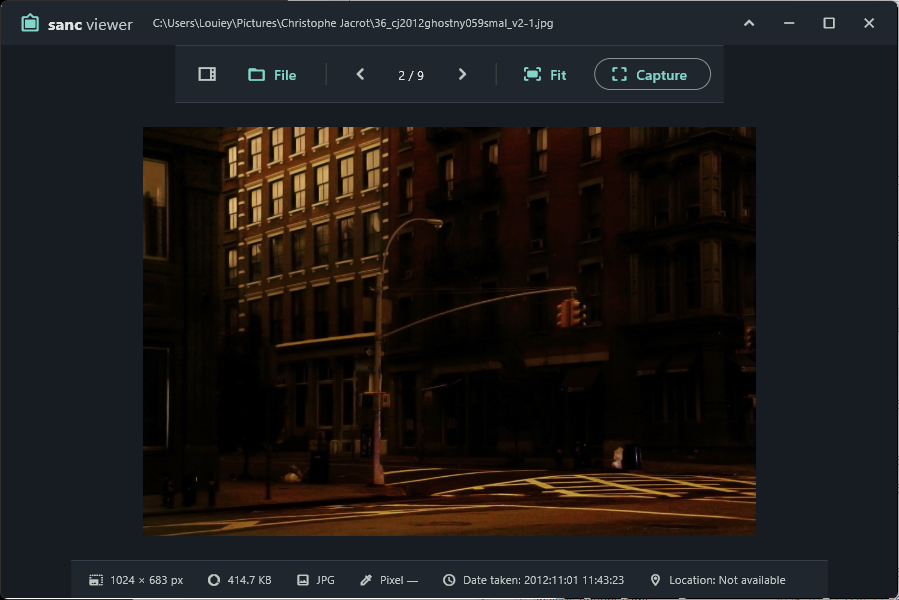

# Sanc Viewer

Flutter 기반 Windows 이미지 뷰어입니다. 폴더의 이미지를 탐색하고,
픽셀 색상과 촬영 정보를 확인하거나 화면을 캡처할 수 있습니다.



## 주요 기능

- 지원 형식: JPG, JPEG, PNG, GIF, WebP, BMP, ICO.
- 폴더 탐색, 이전·다음 이미지 이동, 확대·축소 및 화면 맞춤.
- 마우스 위치의 픽셀 좌표, RGB, HEX 색상 표시.
- 이미지 해상도, 파일 크기, 형식, EXIF 촬영 일시 표시.
- EXIF GPS 정보가 있으면 Google Maps에서 위치 열기.
- 영역·창·전체 화면 캡처와 PNG 저장.
- 현재 이미지 클립보드 복사.
- Light/Dark 모드, 사이드바 너비 조절, 도구 모음 접기·펼치기.
- 마지막 폴더·이미지, 테마, 사이드바, 도구 모음, 창 크기와
  최대화 상태 저장 및 복원.
- Windows 이미지 형식 연결 등록 및 기본 앱 설정 화면 열기.

## 설치 및 실행

Windows 10/11 x64용 설치 파일을 실행합니다.
Flutter나 Visual Studio는 사용자 PC에 설치할 필요가 없습니다.

```text
dist/SancViewer-0.1.0-windows-x64-Setup.exe
```

설치 파일은 아래의 설치 프로그램 생성 절차로 만듭니다.
`dist`와 `build` 폴더는 버전 관리에서 제외됩니다.

- 기본 설치 위치: `%LOCALAPPDATA%\Programs\SancViewer`.
- 현재 사용자 계정에 설치하며 관리자 권한이 필요하지 않습니다.
- 시작 메뉴 바로가기를 생성하고 바탕화면 바로가기는 선택할 수 있습니다.
- 이미지 형식 등록 여부를 선택할 수 있습니다.
- 제거는 Windows 설정의 설치된 앱에서 진행합니다.
- 설정 파일은 업데이트 및 제거 후에도 보존합니다.

현재 생성된 설치 파일에는 코드 서명이 적용되어 있지 않습니다.

## 사용법

### 이미지와 폴더 열기

1. **File > Open folder…**로 이미지 폴더를 선택합니다.
2. 왼쪽 사이드바에서 폴더를 이동하거나 이미지를 선택합니다.
3. **Open images…**로 파일을 직접 선택할 수도 있습니다.
4. 도구 모음의 이전·다음 버튼 또는 방향키로 이미지를 이동합니다.

Windows에서 이미지를 더블클릭하여 실행하면 해당 이미지를 우선 엽니다.
일반 실행 시에는 마지막 폴더와 선택 이미지를 복원합니다.

### 이미지 확인

- 마우스 휠로 확대·축소하고 드래그로 이미지를 이동합니다.
- **Fit**을 누르면 확대·이동 상태를 초기화하여 화면에 맞춥니다.
- 이미지 위에 마우스를 올리면 하단에 픽셀 좌표와 RGB·HEX가 표시됩니다.
- 하단에는 해상도, 크기, 형식, 촬영 일시, 위치도 표시됩니다.
- 위치 정보가 있으면 **Location**을 눌러 Google Maps를 엽니다.
- 이미지에 EXIF 정보가 없으면 해당 항목은 `Not available`로 표시됩니다.

### 화면 캡처와 복사

1. **Capture** 메뉴에서 캡처 범위를 선택합니다.
   - **Capture region**: 선택 영역.
   - **Capture window**: 선택 창.
   - **Capture screen**: 전체 화면.
2. 캡처가 뷰어에 표시되면 **Save**로 PNG 파일을 저장합니다.
3. 현재 표시된 이미지는 **Ctrl+C**로 복사한 뒤 다른 앱에 붙여넣습니다.

**Save**와 **Ctrl+S**는 캡처 이미지 저장용입니다.
일반 이미지 편집·저장 기능은 제공하지 않습니다.

### 화면 구성과 설정 유지

- **File > Light mode / Dark mode**에서 테마를 선택합니다.
- 도구 모음 왼쪽 사이드바 버튼으로 탐색기를 접고 펼칩니다.
- 사이드바 오른쪽 경계를 드래그하여 너비를 조절합니다.
- 타이틀 바의 최소화 버튼 왼쪽 **∧ / ∨**로 도구 모음을 접고 펼칩니다.
- **File > Info**에서 앱 버전을 확인합니다.
- 테마, 마지막 폴더·이미지, 사이드바 상태·너비, 도구 모음 상태,
  창 크기·최대화 여부는 재실행 시 복원합니다.
- 창이 최대화되어도 최대화 해제 시 사용할 일반 창 크기를 보존합니다.

설정은 다음 파일에 저장합니다.

```text
%APPDATA%\SancViewer\settings.json
```

### Windows 파일 연결

1. **File > File associations**를 선택합니다.
2. 지원 이미지 형식을 현재 사용자 계정에 등록합니다.
3. 열린 Windows 기본 앱 설정에서 **Sanc Viewer**를 선택하고
   원하는 이미지 형식의 기본 앱으로 지정합니다.

기본 앱 지정은 Windows 설정 화면에서 사용자가 최종 확정해야 합니다.
실행 파일을 다른 위치로 옮겼다면 이 메뉴로 다시 등록합니다.

## 단축키

앱 창에 포커스가 있을 때 사용합니다.
도구 모음을 접은 상태에서도 사용할 수 있습니다.

| 단축키         | 동작                                 |
| -------------- | ------------------------------------ |
| `Ctrl+O`       | 이미지 파일 열기                     |
| `←`            | 현재 폴더의 이전 이미지              |
| `→`            | 현재 폴더의 다음 이미지              |
| `Ctrl+C`       | 현재 표시된 이미지를 클립보드에 복사 |
| `Ctrl+Shift+C` | 영역 캡처                            |
| `Ctrl+S`       | 현재 캡처 이미지를 PNG로 저장        |

## 개발 환경에서 실행

필요한 도구는 Flutter SDK, Dart SDK 3.9.2 이상,
Visual Studio의 **Desktop development with C++** 워크로드입니다.
프로젝트의 Dart SDK 조건은 `pubspec.yaml`에서 확인할 수 있습니다.

아래 명령은 Windows PowerShell 기준입니다.

```powershell
Set-Location D:\GIT\GitHub\sanc_viewer
flutter doctor -v
flutter pub get
flutter run -d windows
```

코드 검사와 테스트:

```powershell
flutter analyze
flutter test
```

## Windows 설치 프로그램 생성

설치 마법사가 있는 단일 `Setup.exe`를 생성합니다.
제작 도구는 Inno Setup이며, 설정 파일은
[installer/sanc_viewer.iss](installer/sanc_viewer.iss),
빌드 스크립트는 [installer/build.ps1](installer/build.ps1)입니다.

### 준비

1. 위의 Flutter 및 Visual Studio 개발 환경을 준비합니다.
2. Inno Setup 컴파일러 `ISCC.exe`를 준비합니다.
   현재 검증한 버전은 [Inno Setup 6.4.3][inno-release]입니다.
3. 프로젝트 루트에서 `flutter pub get`을 실행합니다.

빌드 스크립트는 다음 위치에서 컴파일러를 찾습니다.

- `build\installer-tools\inno\ISCC.exe`.
- `C:\Program Files (x86)\Inno Setup 6\ISCC.exe`.
- `C:\Program Files\Inno Setup 7\ISCC.exe`.
- `PATH`에 등록된 `ISCC.exe`.

현재 작업 PC에는 첫 번째 위치에 포터블 컴파일러가 있습니다.
`build` 폴더를 지우거나 다른 PC에서 빌드할 경우 다시 준비해야 합니다.

### 빌드 명령

프로젝트 루트의 PowerShell에서 실행합니다.
실행 정책 옵션은 이 명령으로 실행되는 프로세스에만 적용됩니다.

```powershell
powershell -NoProfile -ExecutionPolicy Bypass -File installer/build.ps1
```

스크립트가 다음 작업을 순서대로 수행합니다.

1. Flutter Windows Release 빌드.
2. 실행 파일, 플러그인, 자산 확인.
3. 빌드에 사용한 Visual Studio에서 x64 Visual C++ 런타임 DLL 수집.
4. Inno Setup으로 설치 파일 생성.
5. 설치 파일의 SHA-256 검증 파일 생성.

이미 생성한 Release 결과물로 설치 파일만 다시 만들려면:

```powershell
powershell -NoProfile -ExecutionPolicy Bypass `
  -File installer/build.ps1 -SkipBuild
```

컴파일러 위치를 직접 지정하려면:

```powershell
powershell -NoProfile -ExecutionPolicy Bypass `
  -File installer/build.ps1 `
  -IsccPath 'C:\Program Files (x86)\Inno Setup 6\ISCC.exe'
```

필요한 경우 아래 매개변수도 지정할 수 있습니다.

| 매개변수              | 의미                                    |
| --------------------- | --------------------------------------- |
| `-SkipBuild`          | 기존 Release 결과물 사용                |
| `-IsccPath`           | Inno Setup 컴파일러 경로                |
| `-FlutterPath`        | Flutter 실행 파일 경로                  |
| `-VCRuntimeDirectory` | x64 Visual C++ CRT DLL이 들어 있는 폴더 |

### 버전과 배포 파일

버전은 `pubspec.yaml`의 `version`에서 읽습니다.
예를 들어 `0.1.0+1`이면 다음 파일이 생성됩니다.

```text
dist/
  SancViewer-0.1.0-windows-x64-Setup.exe
  SancViewer-0.1.0-windows-x64-Setup.exe.sha256
```

사용자에게는 `Setup.exe`를 배포합니다.
파일 무결성을 확인하려면 SHA-256 파일의 값과 아래 결과를 비교합니다.

```powershell
Get-FileHash .\dist\SancViewer-0.1.0-windows-x64-Setup.exe `
  -Algorithm SHA256
```

설치 프로그램은 필요한 런타임과 자산을 함께 배포하므로
Release 폴더의 실행 파일 하나만 따로 전달하지 않습니다.
업데이트 배포 시에는 `pubspec.yaml` 버전을 올려 다시 빌드하고,
기존 설치를 갱신할 수 있도록 설치 스크립트의 `AppId`를 유지합니다.

[inno-release]: https://github.com/jrsoftware/issrc/releases/tag/is-6_4_3
